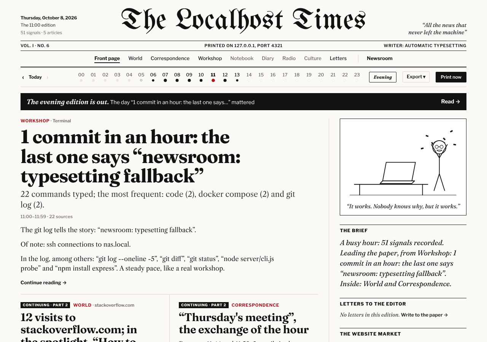
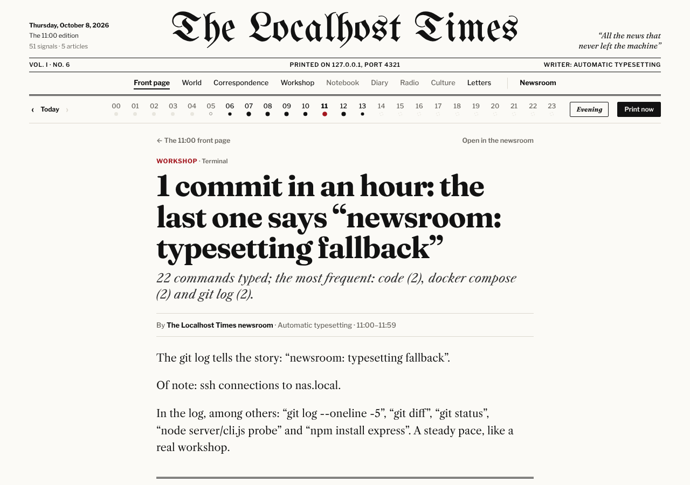
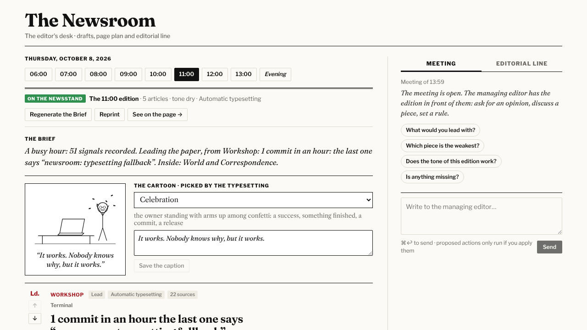
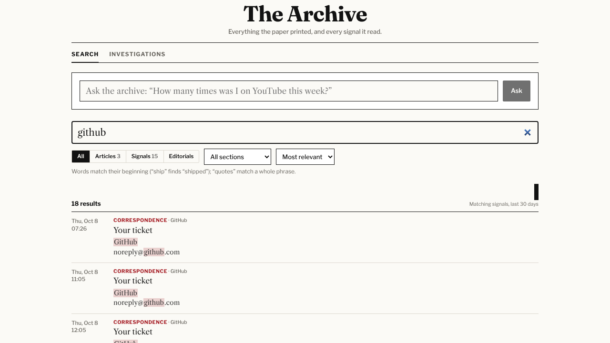
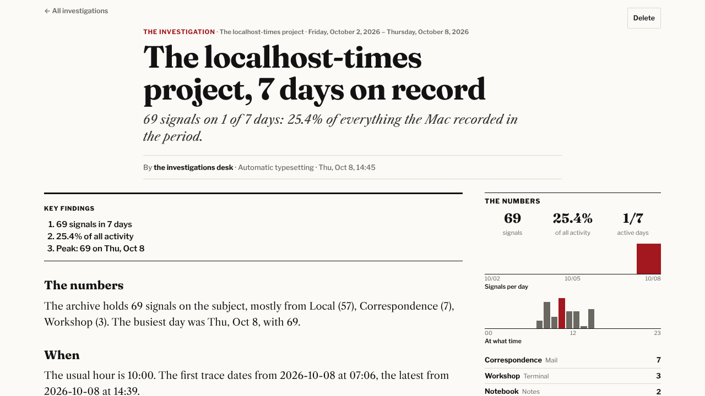
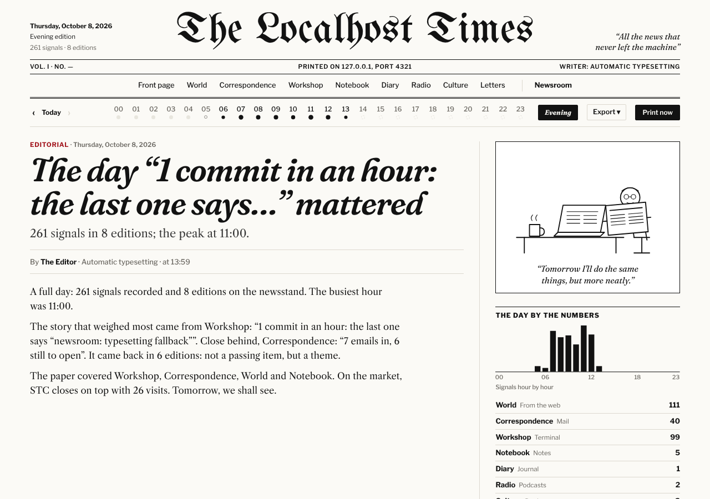

# The Localhost Times

*“All the news that never left the machine.”*

**An hourly newspaper about your own Mac.** Every hour, The Localhost Times reads what your Mac did (the pages you visited in Safari, the mail you received, the commands you typed, the notes you wrote, the folders you worked in, the podcasts you heard), groups it into stories and has a language model **running on your own machine** write them up as a newspaper: front page, sections, cartoons, letters to the editor, a stock market of websites, an evening edition, a searchable archive and investigations.

Nothing leaves your computer. The only thing sent anywhere is the text of the stories, and it goes to the model *you* run.



<table>
<tr>
<td></td>
<td></td>
</tr>
<tr>
<td align="center"><sub>An article, with its sources</sub></td>
<td align="center"><sub>The newsroom: drafts, editorial line, the editorial meeting</sub></td>
</tr>
</table>

## Contents

- [Quick start](#quick-start)
- [Requirements](#requirements)
- [The writer: a local model](#the-writer-a-local-model)
- [Permissions](#permissions)
- [Run it in the background](#run-it-in-the-background)
- [Updating](#updating)
- [What's in the paper](#whats-in-the-paper)
- [Privacy](#privacy)
- [Configuration](#configuration)
- [Commands](#commands)
- [Troubleshooting](#troubleshooting)
- [How it works](#how-it-works)
- [License](#license)

## Quick start

```bash
git clone https://github.com/granvalenti76/the-localhost-times.git
cd the-localhost-times
npm install
npm run demo        # a paper made of invented data → http://localhost:4321
```

The demo needs no permissions and no model. To print *your* paper:

```bash
npm run setup       # language, model, notifications, permissions: a guided 1-minute setup
npm start           # → http://localhost:4321
```

The first edition comes out at the top of the next hour. To see one right away, press **Print now** in the timeline bar.

## Requirements

| | |
|---|---|
| **macOS** | The sources are macOS apps. On other systems only the demo works. |
| **Node.js 22.13 or later** | `brew install node`, or `nvm install 22` (there's an `.nvmrc`). Check with `node -v`. |
| **A local language model** *(optional)* | Any OpenAI-compatible server: [Ollama](https://ollama.com), [LM Studio](https://lmstudio.ai), [llama.cpp](https://github.com/ggml-org/llama.cpp)… Without one, the paper is still printed by the *automatic typesetting*: plainer articles from templates. |

No database or Python to install: storage is SQLite, built into Node.

## The writer: a local model

By default the paper **finds your model by itself**. It looks for Ollama (port 11434), LM Studio (1234), llama.cpp (8080) and vLLM (8000) on this Mac, and uses the first chat model it finds.

For example, with Ollama:

```bash
brew install ollama
ollama serve &              # or open the Ollama app
ollama pull gemma3:4b       # any chat model works; small ones are fine
npm start
```

**Model on another computer** (a home server, a desktop with a GPU): run `npm run setup` and type its address, or set it in `config.json`:

```json
{ "llm": { "baseUrl": "http://192.168.1.20:8080/v1", "model": "" } }
```

Leave `model` empty to use the server's first model. Small local models (3–8B parameters) are enough: the facts are prepared for them, and they only have to write. Requests go one at a time (`llm.concurrency`), and each one may take up to `llm.timeoutMs` (5 minutes by default), so slow machines work too.

When the model is off or doesn't answer, the paper doesn't stop: that hour's articles are written by the automatic typesetting, and the model picks up again at the next edition.

## Permissions

Safari, Mail, Notes, Podcasts, Books and Journal keep their data in folders protected by macOS, and so are Desktop, Documents and Downloads (for the Local section, which also needs Spotlight, on by default). To read them, the app you run the paper from needs **Full Disk Access**:

1. Open **System Settings → Privacy & Security → Full Disk Access**.
2. Turn on the app you start the paper from: **Terminal**, iTerm, VS Code…
3. Quit that app completely (⌘Q) and reopen it.

Check with `npm run probe`: every source shows ✓ (readable), ⛔ (blocked) or · (app not used on this Mac). `npm run setup` can open the right settings page for you.

If your model runs on another computer, macOS may also ask whether the app can find devices on your **Local Network**: say yes.

**Precise times for Terminal commands.** By default zsh saves the history without timestamps, and only when a window closes. Add this line to `~/.zshrc`, then open a new window:

```zsh
setopt EXTENDED_HISTORY INC_APPEND_HISTORY
```

## Run it in the background

Instead of keeping a Terminal window open, install the paper as a background service. It starts at every login, restarts if it crashes, and prints every hour on its own:

```bash
npm run service:install     # builds the site, installs and starts the service
npm run service:status      # is it running? can it read the sources?
npm run service:restart     # rebuild and restart: after an update or a change to config.json
npm run service:stop        # stop it (it starts again with service:start, or at the next login)
npm run service:start       # start it again
npm run service:logs        # follow the log (Ctrl-C to quit)
npm run service:uninstall   # stop it and remove it for good (your editions stay in data/)
```

While the service is running, `npm start` would find the port taken: use `service:stop` first if you want to run the paper in a Terminal window.

As a service, the paper runs as `node` and not inside Terminal, so macOS asks for Full Disk Access again, **for `node` itself**. The install command prints the exact path to add, and `service:status` reminds you if a source is blocked. After a Node.js upgrade the path changes: add the new one.

**Notifications.** When an edition is out you get a macOS notification with the lead headline (turn it off with `"notifications": { "enabled": false }`). Try it with `npm run notify:test`. With `brew install terminal-notifier`, clicking the notification opens the edition.

**The headline in the menu bar.** With [SwiftBar](https://swiftbar.app) (free) the lead headline sits in the macOS menu bar; click it for the edition's stories, what the next edition would lead with, and quick links to the paper, the newsroom and the archive:

```bash
brew install --cask swiftbar   # open it once and choose a plugin folder
npm run menubar:install        # adds the plugin (xbar works too)
npm run menubar:uninstall      # removes it
```

It refreshes every 5 minutes and only asks the paper on this Mac (`/api/menubar`).

## Updating

```bash
git pull
npm install
npm run service:restart     # if it runs as a service; otherwise stop npm start (Ctrl-C) and run it again
```

Your editions, settings and `config.json` are kept. New features that need new settings get their defaults automatically.

## What's in the paper

| Source | Section | What is read |
|---|---|---|
| Safari | World | History of this Mac (not iCloud), searches on Google & co., Gmail subjects in the browser |
| Mail | Correspondence | Sender, subject, sent or received. **Not** the body of your emails. |
| Terminal | Workshop | `~/.zsh_history` / `~/.bash_history`, with tokens and passwords redacted |
| Notes | Notebook | Notes created or edited: title, folder, a short excerpt |
| Journal | Diary | Journal entries (experimental). The text stays **private** by default. |
| Podcasts | Radio | Episodes played, and how far |
| Books | Culture | Books opened, progress, highlighted passages |
| Files | Local | Folders you worked in (via Spotlight) and downloads with the site they came from. **Not** file names (unless you enable them) or contents. |

Every hour:

- **The front page.** A lead story, sections, briefs and *The Brief*, a two-line summary. Stories that keep coming back become **continuing stories**, with links to the earlier instalments.
- **The cartoon.** The model writes a New Yorker-style caption and picks one of 18 original line drawings to go with it.
- **Fact check.** The model, as a fact-checker, rates the boldest claims of the edition (true, mostly true, false, unverifiable) against the hour's data. In the newsroom, every figure an article quotes that is *not* in its facts gets flagged.
- **The website market.** Every site you visit is a listed stock, its visits are the price, with change and a 12-hour trend.
- **Photos.** Preview images of public pages and YouTube thumbnails. Private, local and webmail pages are never fetched.
- **The radio bulletin.** Every edition is read aloud in about a minute by your Mac's own voice (`say`, built into macOS), with a player on the front page. Subscribe to the bulletins in Podcasts: *File → Follow a Show by URL…* → `http://localhost:4321/radio.xml`. The last 72 bulletins are kept.

Every day:

- **The evening edition** (at 21:00): an editorial about the day, the day's top stories, hour by hour, and the market close.
- **Letters to the editor.** Write to the paper; the managing editor answers in the next edition, with your data at hand.

In **the Archive**:

- **Search** everything the paper printed and every signal it read: articles, editorials, pages, mail subjects, commands, notes, folders. Words match by their beginning; "quotes" match a phrase. A small chart shows when the matches happened.
- **Ask the archive** a question in plain words (*"How many times was I on YouTube this week?"*): the archivist (your model) answers from the matching records, and cites them.
- **Investigations.** Pick a subject and a period (or one of the newsroom's ideas, drawn from the stories that keep coming back): the paper gathers every trace in the archive, computes the numbers, the busiest days and hours and a timeline, and writes a long feature with key findings and charts.

<table>
<tr>
<td></td>
<td></td>
</tr>
</table>

In **the Newsroom** you are the editor-in-chief:

- **Drafts.** Reorder, edit, rewrite with an instruction, or spike any article.
- **The bylines.** The paper has a staff of invented writers, each with a voice: a web correspondent, a technology correspondent, the city desk, a critic and a columnist who signs *The Brief* and the evening editorial. The model is the same; it plays a different character for each. In *Editorial line* choose who writes each section, and rename them or rewrite their style.
- **The editorial line.** Set the tone (dry, ironic, satirical, understatement, tabloid), the article length and how much room each section gets, and give permanent rules to the writers. Turn off automatic publishing to approve every edition before it goes out.
- **The editorial meeting.** Discuss an edition with the managing editor (the model). It proposes concrete actions, and you apply them with one click. It can also look things up while you talk: the next edition before it's printed (signals collected so far, stories forming, minutes left), the facts behind a story, the day so far, the archive.
- **The next edition.** See what the coming edition will contain while the hour is still running, and steer it: pick its lead, leave a story out, give the writers a one-off instruction, or print it right away. Your choices apply to that edition only. The managing editor can propose the same moves in the meeting.

**Export** (in the timeline bar) prints the front page to PDF in A4 or A3 broadsheet, saves it as a 1200×630 image, or gives you the RSS feed (`/feed.xml`, or `/feed/<section>.xml` for one section).

The paper is written in **English or Italian** (`"language": "en"` or `"it"`).



## Privacy

- **Local by design.** The paper is served on `127.0.0.1`, so other devices on your network can't open it. Your editions live in `data/` in the project folder.
- **Read-only.** App databases are read from a temporary **copy**, never opened directly, never modified.
- **What leaves the machine:** only the stories' facts, sent to the model address you configured. If the model runs on this Mac, nothing leaves at all. Photos are fetched from the public web pages you visited, unless you turn them off in the Newsroom.
- **What is never read:** the body of your emails (unless you enable `mailIncludeSummary`), the text of Journal entries (unless `journalIncludeText`), locked notes, iCloud history from other devices, the contents of your files. File names stay out too unless you set `files.includeNames`; build folders (`node_modules`, `dist`, `.git`…) and hidden files are ignored.
- **Filters:** `privacy.blockedDomains`, `blockedMailSenders`, `blockedNoteFolders` and `files.exclude` in `config.json` keep anything you choose out of the paper. Terminal commands are scanned for tokens, keys and passwords, which are redacted.
- **Other websites can't reach it.** Requests addressed to any host other than this Mac are refused, and data-changing API calls need a header that a page on another site can't send.
- **No telemetry, no accounts, no cloud.**

## Configuration

`npm run setup` writes `config.json` for you. To edit it by hand, start from [`config.example.json`](config.example.json). Every field is optional: whatever you leave out keeps its default.

| Setting | Default | What it does |
|---|---|---|
| `language` | `"en"` | `"en"` or `"it"` |
| `port` | `4321` | Where the paper is served |
| `host` | `"127.0.0.1"` | Only this Mac can open the paper. `"0.0.0.0"` shares it with your network: anyone on it could read it. |
| `llm.baseUrl` | `"auto"` | `"auto"` finds a local server; a URL ending in `/v1`; or `""` for no model |
| `llm.model` | `""` | Model name; empty = the server's first chat model |
| `llm.apiKey` | `""` | Only if your server wants one |
| `llm.timeoutMs` | `300000` | How long to wait for each answer |
| `llm.concurrency` | `1` | Requests in parallel (1 suits local servers) |
| `llm.thinking` | `false` | Let "thinking" models reason before writing (slower) |
| `sources.<name>` | `true` | Turn a source off |
| `files.folders` | Desktop, Documents, Downloads, Work, Developer, Projects, Code… | Folders the Local section watches |
| `files.exclude` | `[]` | Parts of paths to leave out, e.g. `"Documents/Medical"` |
| `files.includeNames` | `false` | Put file names in the paper (otherwise only folders, types and counts) |
| `privacy.*` | | See [Privacy](#privacy) |
| `edition.maxArticles` | `9` | Articles per edition |
| `edition.minEvents` | `8` | Quieter hours merge into the next edition… |
| `edition.maxMergeHours` | `3` | …up to this many hours |
| `edition.eveningHour` | `21` | When the evening edition comes out (`null` = never) |
| `notifications.enabled` | `true` | macOS notification for every edition |
| `radio.enabled` | `true` | Record the radio bulletin of every edition |
| `radio.voice` | `""` | A `say` voice (list them with `say -v '?'`); empty = one that speaks the paper's language |
| `radio.rate` | `180` | Words per minute |
| `backfillHours` | `1` | Editions to catch up on after the Mac was off |
| `keepEventsDays` | `60` | How long raw signals are kept (editions are kept forever); `0` = forever |

Environment variables override the file: `LOCALHOST_TIMES_LANG`, `LOCALHOST_TIMES_LLM_URL`, `LOCALHOST_TIMES_LLM_MODEL`, `PORT`.

## Commands

| Command | |
|---|---|
| `npm run setup` | Guided setup (safe to run again) |
| `npm start` | Build the site and start the paper |
| `npm run demo` | The paper with invented data, no permissions needed |
| `npm run probe` | Check sources, permissions and the model |
| `npm run print -- --hours 3` | Print the editions of the last hours now |
| `npm run rebuild` | Wipe the paper and reprint the last 12 hours |
| `npm run photos -- --hours 4` | Trace the photo search, page by page |
| `npm run service:install` | Install and start the background service |
| `npm run service:restart` / `stop` / `start` | Restart (after an update), stop, start the service |
| `npm run service:status` / `logs` / `uninstall` | Check it, follow its log, remove it |
| `npm run notify:test` | Send a test notification |
| `npm run menubar:install` / `uninstall` | Add or remove the menu-bar headline (SwiftBar or xbar) |
| `npm run dev` | Development, with hot reload → http://localhost:5173 |
| `npm test` | Run the tests |

## Troubleshooting

**`npm start` says Node is too old, or `vite: command not found`.** Install Node 22.13+ and run `npm install` in the project folder.

**The paper is empty.** Editions come out on the hour. Press **Print now** to print the current hour. Run `npm run probe`: ⛔ means a permission is missing (see [Permissions](#permissions)).

**"Writer offline" / "automatic typesetting".** The model isn't reachable. `npm run probe` shows the reason. Check that your model server is running (`curl http://127.0.0.1:11434/v1/models` for Ollama), or that the address in `config.json` ends in `/v1`. For a model on another computer, check the macOS Local Network permission.

**Articles get cut or the model times out.** Use a smaller model, raise `llm.timeoutMs`, and keep `llm.thinking` off.

**Terminal commands have no times.** See the zsh line under [Permissions](#permissions).

**Port 4321 is already in use.** The paper is probably already running, maybe as a service (`npm run service:status`). Or set another `port`.

**The service starts but sources are blocked.** Give Full Disk Access to `node` itself: `npm run service:status` prints its path.

**`config.json is not valid JSON`.** Fix the file, or delete it and run `npm run setup`.

## How it works

```
app databases (read from a copy) ─► collected every 5 min ─► data/*.sqlite (events)
                                                                   │
                                                    on the hour    ▼
             stories (by site, thread, note, book…) ─► writer: local LLM, or typesetting
                                                                   │
                         React front end (web/)  ◄──── Express API (server/)
```

| Path | |
|---|---|
| `server/sources/` | One file per source (`locate()` + `collect()`) |
| `server/newsroom/cluster.js` | From events to stories, and the fact sheets the model writes from |
| `server/newsroom/prompts.js` | The writers' style guide, in both languages |
| `server/newsroom/fallback.*.js` | The automatic typesetting (templates, one file per language) |
| `server/newsroom/scenes.js` | The cartoon catalogue (the drawings are in `web/src/components/Cartoon.jsx`) |
| `server/newsroom/edition.js` | Printing an edition, and the newsroom's desk operations |
| `server/newsroom/archive.js` | Search (SQLite FTS5) and "Ask the archive" |
| `server/newsroom/investigations.js` | Investigations: gathering, numbers, timeline, writing |
| `server/newsroom/factcheck.js` | The fact check and the figures check |
| `server/service.js` | The macOS background service |
| `web/` | The paper: front page, articles, sections, newsroom |
| `test/` | Tests (`npm test`) |

**Adding a source** means one file in `server/sources/` that finds the app's database and returns events (`{ id, source, kind, ts, title, detail, url, meta }`), a section in `server/newsroom/sections.js`, and a story builder in `cluster.js`.

**Journal is experimental.** Apple doesn't document where Journal stores its entries on the Mac, so the collector looks for likely databases on its own. If it finds nothing, `npm run probe` lists the candidate folders and tables (names only, no contents): please open an issue with that output.

## License

[MIT](LICENSE)
