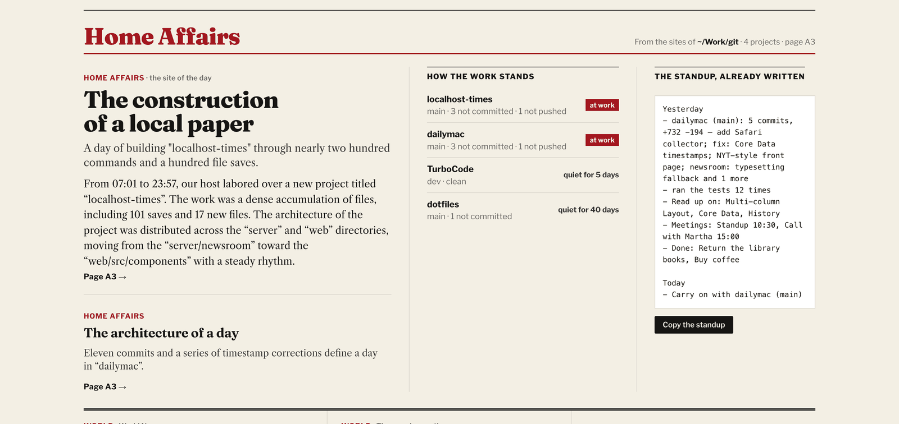
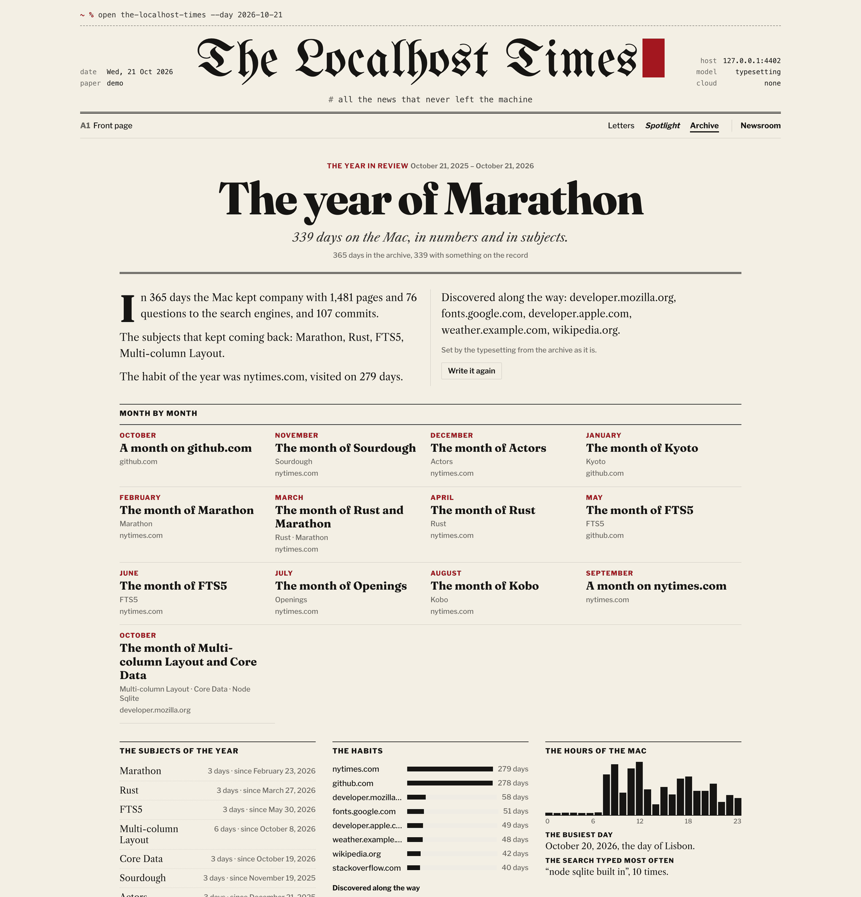

# The Localhost Times

[](https://github.com/granvalenti76/the-localhost-times/actions/workflows/ci.yml)
[](LICENSE)

*“All the news that never left the machine.”*

**A daily newspaper about your Mac, written by your local LLM.** Every morning at 7:00, The Localhost Times reads what your Mac did yesterday (the pages you visited in Safari, the mail you received, the commands you typed, the notes you wrote, the folders and repositories you worked in, the podcasts you heard) and a language model **running on your own machine** writes it up as a paper, in the manner of The New Yorker. It takes five minutes to read.

Nothing leaves your computer.


## Quick start

```bash
git clone https://github.com/granvalenti76/the-localhost-times.git
cd the-localhost-times
npm install
npm run demo        # a paper made of invented data → http://localhost:4321
```

The demo needs no permissions and no model. To print *your* paper:

```bash
npm run setup       # language, cadence, model, permissions: about a minute
npm start           # → http://localhost:4321
```

On the first start the paper reads the past your Mac already keeps (a year of Safari, Mail, Books, Podcasts, the shell and git), so there is something to read at once: the editions of the last week, *a year ago today*, the Year in Review. To keep it running in the background, see [docs/SETUP.md](docs/SETUP.md#run-it-in-the-background).

**You need** macOS, Node.js 22.13 or later, and ideally a local model server ([Ollama](https://ollama.com), [LM Studio](https://lmstudio.ai), [llama.cpp](https://github.com/ggml-org/llama.cpp)…): the paper finds it on its own. Without a model, it is still printed from templates, in plainer prose.

## What's in it

- **Home Affairs (Interni), your projects.** Choose the folder of your repositories in the Settings: the paper reads them (never writes) and every morning tells what you built, in your own commit messages, where in the project the work went, what was born, which dependencies arrived; and keeps a board of how every project stands: work not committed and since when, commits not pushed, projects gone quiet. Each project has its own page.
- **What you were busy with, not where.** The stories are subjects: a trip searched on Google, booked by mail, read about on three travel sites and noted in Notes is one piece, followed from day to day, not four entries in a log.
- **The Year in Review:** the subjects of every month, the habits and the discoveries, the hours the Mac kept, the books, the shows, the repositories. And on the front page, *a year ago today*.
- **A memory, without screenshots.** *“What was that article about the trams in Lisbon I read on Tuesday?”*: the archive answers with the page itself, and its link. From the paper, the menu bar or `npm run recall`.
- **The standup, written by itself:** yesterday's commits, pull requests, pushes, tests and meetings, ready to paste. One click in the menu bar, or `npm run standup -- --copy`.
- **A front page laid out like a paper:** the day in a strip at the top, a lead with its engraving, the pages numbered by section (A1, A2…), *The Brief*, a New Yorker-style cartoon, *in this issue*, the website market, the records the day broke, and **Spotlight**, the patterns across weeks you may not have noticed.
- **Every morning:** a notification with the lead headline, a one-minute radio bulletin read by your Mac's own voice, the RSS feed, the headline in the menu bar.

The paper can also come out every hour or every week, in English or Italian. The house voice is in the [style guide](docs/STYLE.md).

<table>
<tr>
<td width="50%"></td>
<td width="50%"></td>
</tr>
<tr>
<td align="center"><sub>Home Affairs: your projects, how they stand, the standup</sub></td>
<td align="center"><sub>A subject, followed across apps</sub></td>
</tr>
<tr>
<td colspan="2"></td>
</tr>
<tr>
<td colspan="2" align="center"><sub>The Year in Review, from the past the Mac already keeps</sub></td>
</tr>
</table>

<sub>All screenshots are of the demo (`npm run demo`): invented data, written by a local Gemma.</sub>

## Privacy, in five lines

- The paper is served on `127.0.0.1` only, and keeps everything in `data/` in this folder.
- App databases are opened **read-only**; email bodies, file contents and Journal text are never read.
- The only thing sent anywhere is the stories' facts, to the model address *you* configured.
- Delicate subjects (health, money, love, faith, politics, the law, job hunting) are never turned into stories.
- No telemetry, no accounts, no cloud. More in [docs/PRIVACY.md](docs/PRIVACY.md).

## Why only the Mac

It is a paper about a Mac, written from the Mac's own apps: Safari, Mail, Notes, Terminal, Podcasts, Books, Photos, Calendar, Reminders, Files and Git. Chrome and Firefox are left out by choice. See [docs/SOURCES.md](docs/SOURCES.md).

## Documentation

| | |
|---|---|
| [SETUP.md](docs/SETUP.md) | The model, permissions, the background service, notifications, the menu bar, commands, troubleshooting |
| [CONFIG.md](docs/CONFIG.md) | Every setting in `config.json` |
| [SOURCES.md](docs/SOURCES.md) | What each source reads, how it works, adding a source |
| [PRIVACY.md](docs/PRIVACY.md) | What is read, what is never read, what leaves the machine |
| [STYLE.md](docs/STYLE.md) | The style guide: one voice for the whole paper |
| [CONTRIBUTING.md](CONTRIBUTING.md) | How to help |
| [CHANGELOG.md](CHANGELOG.md) | What changed, release by release |

## License

[MIT](LICENSE)
